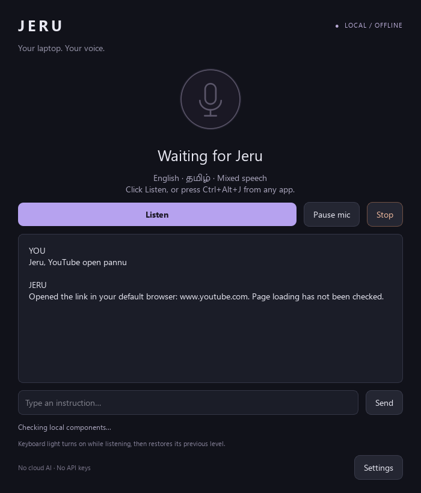

# Jeru

A native Windows desktop voice assistant for English, Tamil, and mixed speech. Say **Jeru**, give a command, and open a site, launch an app, find a local movie, control media, or create a coding proposal. Speech recognition, command interpretation, and speech output run locally, without cloud AI or API keys.

**Version 0.1.1 · Windows preview · Python 3.11 · Native Qt interface**



*Scripted interface preview. It illustrates the native app, not a live microphone benchmark.*

The original brief called for an installable, local voice assistant with English/Tamil commands, a wake name, and keyboard lighting while listening. This implementation uses registered Windows actions and local models. The approved architecture and later milestones are in [JERU_PLAN.md](JERU_PLAN.md); measured checks and known failures are in [VALIDATION.md](VALIDATION.md).

**Current limits:** English synthetic voice checks pass. Tamil microphone recognition is experimental and still needs real-user calibration. Local coding saves proposals for review; it does not automatically run or certify generated applications. Supported actions are finite, rather than unrestricted control of every app.

## Run from source

Use **64-bit Windows and Python 3.11** for the tested setup. The local models and native dependencies require substantial disk space; they are downloaded once during setup. A GPU is not required for the current CPU inference path.

```powershell
git clone https://github.com/Logesh-vr/JERU.git
cd JERU
powershell -ExecutionPolicy Bypass -File scripts\setup.ps1 -Profile balanced
```

Then double-click **Launch Jeru.cmd**, or run:

```powershell
.\.venv\Scripts\python.exe -m jeru
```

The setup script installs pinned dependencies from [requirements-lock.txt](requirements-lock.txt), including the CPU llama.cpp Python wheel, and provisions the selected local models. Initial setup needs internet. After preparation, assistant processing runs offline. Opening YouTube or other websites still needs a browser connection.

English replies require an installed female Windows speech voice; Microsoft Zira was verified on the development laptop. For Tamil speech output in a source checkout, install [eSpeak NG](https://github.com/espeak-ng/espeak-ng/releases) in its normal Windows location, or place its executable and data at `runtimes/espeak-ng/`. Missing voices leave responses available as text.

This repository contains source, tests, documentation, and setup/build scripts. Downloaded model weights, native runtimes, private installers, virtual environments, recordings, and local assistant data are excluded from Git. The installer tested during development is a local build; this source upload does not publish a downloadable binary release.

## Use

Open the installed **Jeru** shortcut or the portable `Jeru.exe`. From source, double-click **Launch Jeru.cmd** after setup.

1. Click **Listen**, or press **Ctrl+Alt+J** from another app.
2. Speak a command. When wake listening is enabled, say **Jeru** before later commands.
3. The keyboard backlight turns on during command listening on supported Lenovo white-backlit keyboards. Its previous brightness is restored when recording ends.
4. Use **Pause mic** to stop microphone capture. **Stop** / **Ctrl+Alt+K** cancels a pending task and speech.

The microphone is paused on a normal first launch. Closing the window keeps Jeru in the tray; choose **Quit Jeru** in the tray menu to exit. The optional start-at-sign-in setting explicitly starts listening after launch.

### Commands

- `Jeru, open YouTube` / `YouTube open பண்ணா` / `யூடியூப் ஓப்பன் பண்ணுங்க` / `யூடியூப் திற`
- `Open Downloads` / `open my college work folder` after saving an alias
- `Search YouTube for Tamil film songs`
- `Volume down` / `volume konjam kammi pannu` / `சத்தம் குறை`
- `Pause the movie`, `next song`, `mute`
- `Play movie Interstellar` after selecting movie folders
- `Note buy milk`, `set a timer for 5 minutes`, `what time is it`
- `Create a Python project called expense tracker` creates an honest starter scaffold
- `Build a Python tool that ...` generates source locally into a separate proposal folder
- `Type this: ...` asks for confirmation before pasting into the previously focused app
- `Close window`, `lock laptop`, and shutdown/restart commands require confirmation

Window and dictation commands need a captured target: activate Jeru with **Ctrl+Alt+J while the target application is focused**. Dictation replaces the clipboard. Timers require Jeru to remain running and are not persistent alarms.

### Settings

- Choose a microphone, automatic/English/Tamil recognition, and the preferred reply language.
- Adjust silence timing and microphone threshold for quiet speech or fan noise.
- Set movie folders, the projects folder, and names for particular folders or apps.
- Select a provisioned model folder containing `speech/`, `wake/`, and `brain/`.
- Test the keyboard light for two seconds. If direct driver access fails, an optional helper can request Windows administrator consent for keyboard brightness only. It is not required on the tested Lenovo Energy-driver path.
- Enable start-at-sign-in explicitly. No startup setting is changed during development setup.

Preferences are stored under `%LOCALAPPDATA%\Jeru`. Raw audio is not saved. Action history is off by default; local notes use a SQLite database. Development checks use a separate workspace data directory.

## Offline operation and model packs

The app never downloads missing models. One-time preparation needs internet; normal operation after preparation does not. Websites and newly downloaded programming dependencies have their own internet needs.

To provision another model profile, run:

```powershell
powershell -ExecutionPolicy Bypass -File scripts\setup.ps1 -Profile balanced
```

The packaged balanced profile uses multilingual Whisper small and Qwen3-0.6B Q8. Quality profile uses Whisper small and Qwen3-4B Q4. Compact profile uses Whisper base and Qwen3-0.6B Q8; base failed the synthetic Tamil sample and is not the recommended bilingual setup. The small local AI model has limited reasoning and coding capability. Tamil/mixed recognition quality must be judged with the user's microphone. The profiles can be upgraded without changing the interface.

Downloads are explicit, resumable, and recorded in model manifests. Hugging Face model weights are checked against the publisher's published SHA256 when available. Archive downloads also record their obtained checksum; a recorded checksum alone is not an independently authenticated publisher signature.

```powershell
.\.venv\Scripts\python.exe scripts\provision.py all --profile balanced
.\.venv\Scripts\python.exe scripts\verify_models.py
```

Changing profile uses the same model folders; stop Jeru first. The one-time setup does not automatically fetch the optional Tamil voice binary. Packaged builds bundle eSpeak NG; source builds can use an installed eSpeak NG or `runtimes/espeak-ng/espeak-ng.exe` with its data folder.

English replies use an installed offline female Windows voice (Microsoft Zira on the tested laptop). Tamil replies use eSpeak NG's female variant (`ta+f3`) and sound synthetic. A natural Tamil voice remains a future quality improvement. Jeru does not fall back to an online voice. Notes are saved only by explicit registered note commands; the local model cannot invent and save a note from an unrecognized command.

## Coding boundary

Direct project commands create scaffolds and preserve the task brief. `Build ...` additionally calls the local model, validates generated file paths, saves proposed code under `generated-proposal/`, and parses Python/JSON syntax without executing it. Read `GENERATION_REPORT.md`; syntactic validity does not establish working behavior.

Generated source is **not automatically run**, dependencies are **not automatically installed**, and no project is published. The next coding milestone needs explicit execution review or a validated operating-system sandbox. Opening the installed Codex app is supported separately from local inference; hosted Codex is never used as a silent fallback.

## Build and verification

Unit tests run with fake model/audio/device adapters and do not download models or record the microphone. For a test-only environment:

```powershell
py -3.11 -m venv .venv
.\.venv\Scripts\python.exe -m pip install -r requirements-test.txt
New-Item -ItemType Directory -Path artifacts -Force | Out-Null
.\.venv\Scripts\python.exe -m pytest -q --basetemp artifacts\test-temp
```

**88 tests passed locally** on the source prepared for this repository. The Windows CI workflow runs the same suite. The packaged 0.1.1 application also passed local model-loading, female speech synthesis, and command-routing checks; those are distinct from live microphone and clean-machine validation.

To build the application after the full source setup:

```powershell
powershell -ExecutionPolicy Bypass -File scripts\build.ps1 -IncludeModels -Installer
```

For installer generation, place the [Inno Setup compiler](https://jrsoftware.org/isinfo.php) and its supporting files at `runtimes/innosetup/` so `ISCC.exe` is present. That compiler is a local build prerequisite and is not included in Git. Omitting `-Installer` produces the directory bundle at `dist/Jeru/`. `-IncludeModels` verifies and copies manifest-listed models; keep the eSpeak executable and its data in `runtimes/espeak-ng/` when bundling Tamil speech.

The installer is written to `releases/Jeru-Setup-0.1.1.exe`, installs per-user, and includes an uninstaller. End users of a complete installer do not need Python. Development builds are unsigned. Review bundled third-party notices and redistribution requirements before publishing binaries.

The hardware backlight probe on this Lenovo reported **off → high → off**, confirming the original state was restored. Unit tests cover command routing and execution boundaries. See `VALIDATION.md` for the actual packaged, audio, model, and user-device verification results as they are completed.

## Implementation

| Path | Responsibility |
| --- | --- |
| `jeru/ui.py`, `app.py` | Native Qt window, tray, settings, confirmations, and task orchestration |
| `jeru/voice.py` | Local capture, sherpa-onnx wake detection, and faster-whisper transcription |
| `jeru/intents.py`, `actions.py` | Bilingual rules, structured-action validation, and registered Windows actions |
| `jeru/ai.py`, `ai_worker.py` | Isolated local llama.cpp/Qwen inference, without a model server |
| `jeru/speech.py` | Offline female Windows English voice and synthetic female Tamil output |
| `jeru/lighting.py` | Reversible Lenovo white keyboard lighting |
| `jeru/projects.py` | Scaffold creation and validation/storage of generated proposals |
| `scripts/`, `tests/`, `installer/` | Setup, diagnostics, packaging, regression tests, and Inno Setup configuration |

Audio is processed locally, raw recordings are not saved, and action history is disabled by default. Local notes are stored only for explicit registered note commands. The local model cannot choose a note-saving action or issue arbitrary shell commands. This initial Git commit contains the existing implementation and documentation as one snapshot; it does not reconstruct development history.

Known current limits: supported commands and adapters are finite; general visual clicking, robust arbitrary website control, natural Tamil speech, persistent reminder scheduling, broad conversational memory, and unattended coding are not implemented. Voice activation does not wake a sleeping/powered-off laptop. Keyboard support is specific to the validated Lenovo white-backlight interfaces.

Third-party provenance and redistribution notes are in [THIRD_PARTY_NOTICES.md](THIRD_PARTY_NOTICES.md).
